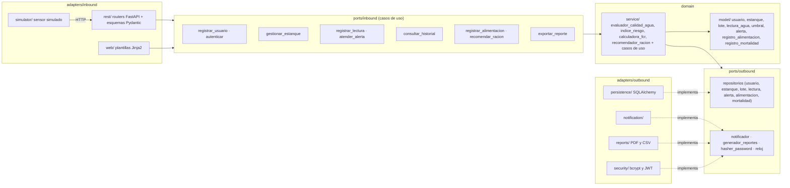

# C4 · Nivel 3 — Diagrama de componentes (aplicación FastAPI)

Regla de dependencia: `adapters -> ports -> domain`. `domain` y `ports` solo usan la biblioteca
estándar (verificado por `tools/check_domain_purity.py` e import-linter).
